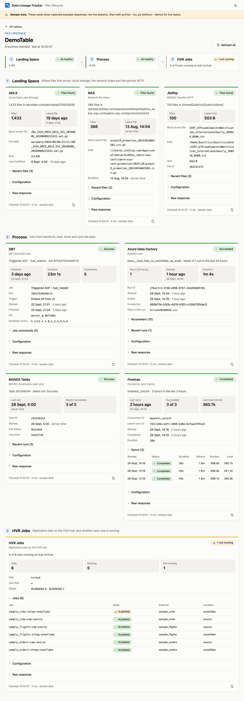

# Data Lineage Tracker: File Lifecycle

A small web app that follows one table's files end to end. Pick a table and it shows:

1. **Landing Space**: whether files arrived in **ADLS**, the **NAS** share and **JbSftp** (MOVEit Transfer).
2. **Process**: the latest **DBT**, **Azure Data Factory**, **MOVEit Tasks** and **Fivetran** runs.
3. **HVR Jobs**: every HVR replication job and whether it is running.

Which systems, folders and jobs belong to a table is set in the **config table**, [config/ConfigurationFile.csv](config/ConfigurationFile.csv). Each check makes the same API calls as the matching script in [Test/](Test/).



## Quick start (on the AVD)

Run it on the AVD: ADLS, NAS, JbSftp, MOVEit Tasks and HVR can only be reached from the AVD network. It uses the same `.env` file as the Test scripts, in the project root.

```powershell
cd "<path to>\data-lineage-tracker"
python -m pip install -r requirements.txt
python run.py
```

Then open **http://localhost:8000**, choose **DemoTable** and click **Track lifecycle**. Press `Ctrl+C` in the terminal to stop.

## Other ways to run

| Command | Use it to |
|---|---|
| `python run.py --demo` | Present without connecting to anything. It serves captured sample responses, labelled "Sample data" on every page. |
| `python run.py --port 8080` | Use another port if 8000 is taken. |
| `python run.py --host 0.0.0.0` | Let colleagues open it from their machines. There is no login, so only do this on a trusted network. |
| `python run.py --reload` | Restart automatically while you edit backend code. |

On macOS or Linux, use `python3` instead of `python`. From a Mac, the ADF, DBT and Fivetran checks work live. The other five report "Couldn't check" with a hint to use the AVD.

## Learn more

The **[File Lifecycle guide](docs/FILE_LIFECYCLE_GUIDE.md)** covers the concepts, the config table and how to add a table, what each status means, the API, and troubleshooting.

## Project layout

```
backend/                 FastAPI app
  main.py                API routes, and serves the frontend
  config_table.py        reads and validates config/ConfigurationFile.csv
  runner.py              runs one check and wraps the result as a status card
  sources/               one module per system, each mirroring a Test/ script
  sample_data.json       responses used by --demo
frontend/                two pages, plain HTML/CSS/JS (no build step)
config/ConfigurationFile.csv   the config table
Test/                    the original standalone scripts (still read .config)
tests/                   unit tests
run.py                   starts the app
```

## Tests

```powershell
python -m unittest discover -s tests -t .
```
