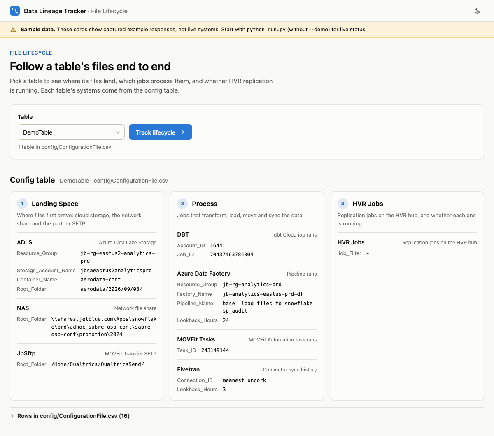

# File Lifecycle guide

This guide explains what the File Lifecycle tracker shows, how the config table drives it, how to run it, and what to do when a card says something is wrong. For the short version, see the [README](../README.md).

- [1. The idea: a table's file lifecycle](#1-the-idea-a-tables-file-lifecycle)
- [2. How it works](#2-how-it-works)
- [3. The config table](#3-the-config-table)
- [4. Running the tracker](#4-running-the-tracker)
- [5. Using the pages](#5-using-the-pages)
- [6. What each status means](#6-what-each-status-means)
- [7. How each card relates to its Test script](#7-how-each-card-relates-to-its-test-script)
- [8. API](#8-api)
- [9. Troubleshooting](#9-troubleshooting)
- [10. Presenting it in five minutes](#10-presenting-it-in-five-minutes)
- [11. Tests and next steps](#11-tests-and-next-steps)

---

## 1. The idea: a table's file lifecycle

Data for a table passes through three stages, and each stage runs on different systems. When a table is late or wrong, the question is always the same: where did it stop? The tracker answers that from one page.

| Class | Systems | Question it answers |
|---|---|---|
| **1. Landing Space** | ADLS, NAS, JbSftp | Did the files arrive, how many are there, and how fresh is the newest one? |
| **2. Process** | DBT, Azure Data Factory, MOVEit Tasks, Fivetran | Did the latest run of each job succeed, when, and how long did it take? |
| **3. HVR Jobs** | HVR hub | Are the replication jobs running? |

A **table** here is anything you want to track, such as a Snowflake table or a feed. Each one gets its own entry in the config table, listing the folders, jobs and connections that make up its lifecycle.

## 2. How it works

```
 Browser                          Backend (FastAPI, run.py)                 Systems
 ───────                          ─────────────────────────                 ───────
 Page 1  index.html   ──GET /api/tables──────────►  config_table.py  ◄── config/ConfigurationFile.csv
   choose a table                                    (which systems, folders, jobs)

 Page 2  lifecycle.html
   one card per system ──GET /api/tables/T/sources/adls──►  runner.py ──► sources/adls.py ──► ADLS
   (all requested at once,   .../sources/nas ──────────────►             ──► sources/nas.py  ──► NAS share
    each card fills in       ...                                          ...
    when its answer lands)   .../sources/hvr ──────────────►             ──► sources/hvr.py  ──► HVR hub
                                                               ▲
                                                               └── credentials from .env (never sent to the browser)
```

- The **backend** reads the config table and, for each system, runs a collector in `backend/sources/`. Each collector makes the same calls as its Test script (section 7) and returns a status card as JSON.
- The **frontend** is two plain HTML pages served by the same backend. There is nothing to build, and no Node.js is needed.
- The config table is re-read on every request, so edits appear on the next page load without a restart.
- The app listens on `127.0.0.1` by default, so only the machine it runs on can open it.

## 3. The config table

### Format

`config/ConfigurationFile.csv` has one row per setting:

| Column | Meaning |
|---|---|
| `Table_Name` | The table the setting belongs to, e.g. `DemoTable`. |
| `Class` | `Landing Space`, `Process` or `HVR Jobs`. It must match the source's class. |
| `Source` | The system: `ADLS`, `NAS`, `JbSftp`, `DBT`, `ADF`, `MoveIT_Tasks`, `Fivetran`, `HVR`. |
| `Parameter` | The setting name. See the reference below. |
| `Value` | The setting value. |

A table's entry is simply all rows with its `Table_Name`. A system with no rows for a table shows as **Not configured** on that table's page.

Case doesn't matter in `Class`, `Source` or `Parameter`. `Source` also accepts the card title, e.g. `Azure Data Factory` or `MOVEit Tasks`. The file can be edited in Excel; both "CSV" and "CSV UTF-8" saves work.

### The DemoTable entry

DemoTable holds the values from the old `.config` file:

```csv
Table_Name,Class,Source,Parameter,Value
DemoTable,Landing Space,ADLS,Resource_Group,jb-rg-eastus2-analytics-prd
DemoTable,Landing Space,ADLS,Storage_Account_Name,jbsaeastus2analyticsprd
DemoTable,Landing Space,ADLS,Container_Name,aerodata-cont
DemoTable,Landing Space,ADLS,Root_Folder,aerodata/2026/09/08/
DemoTable,Landing Space,NAS,Root_Folder,\\shares.jetblue.com\Apps\snowflake\prd\adhoc_sabre-osp-cont\sabre-osp-cont\promotion\2024
DemoTable,Landing Space,JbSftp,Root_Folder,/Home/Qualtrics/QualtricsSend/
DemoTable,Process,DBT,Account_ID,1644
DemoTable,Process,DBT,Job_ID,70437463784804
DemoTable,Process,ADF,Resource_Group,jb-rg-analytics-prd
DemoTable,Process,ADF,Factory_Name,jb-analytics-eastus-prd-df
DemoTable,Process,ADF,Pipeline_Name,base__load_files_to_snowflake_sp_audit
DemoTable,Process,ADF,Lookback_Hours,24
DemoTable,Process,MoveIT_Tasks,Task_ID,243149144
DemoTable,Process,Fivetran,Connection_ID,meanest_uncork
DemoTable,Process,Fivetran,Lookback_Hours,3
DemoTable,HVR Jobs,HVR,Job_Filter,*
```

### Sources and parameters

**Bold** parameters are required. Optional ones fall back to the default shown.

| Class | Source | Parameters | Checks | `.env` keys used |
|---|---|---|---|---|
| Landing Space | `ADLS` | **Storage_Account_Name**, **Container_Name**, **Root_Folder**, Resource_Group (shown only) | Every file under the folder: count, total size, newest file | `ADLS_TENANT_ID`, `ADLS_CLIENT_ID`, `ADLS_CLIENT_SECRET` |
| Landing Space | `NAS` | **Root_Folder** (a UNC path) | Every file under the folder: count, newest file | none (uses your Windows login) |
| Landing Space | `JbSftp` | **Root_Folder** | Files in the MOVEit Transfer folder, newest first | `TRANSFER_SERVER`, `TUSERNAME`, `TPASSWORD` |
| Process | `DBT` | **Account_ID**, **Job_ID** | The job's latest run, with its steps | `DBT_SECRET`, `DBT_ACCESS_URL` |
| Process | `ADF` | **Resource_Group**, **Factory_Name**, **Pipeline_Name**, Lookback_Hours (24) | The pipeline's runs in the window, and the latest run in full | `ADF_TENANT_ID`, `ADF_CLIENT_ID`, `ADF_CLIENT_SECRET`, `ADF_SUBSCRIPTION_ID` |
| Process | `MoveIT_Tasks` | **Task_ID** | The task's run log: latest exit status and recent runs | `WEBADMIN_SERVER`, `USERNAME`, `PASSWORD` |
| Process | `Fivetran` | **Connection_ID**, Lookback_Hours (3) | The connection's syncs in the window | `FIVETRAN_API_KEY`, `FIVETRAN_API_SECRET` |
| HVR Jobs | `HVR` | Job_Filter (`*` = all jobs), Hub_Name (`HVR_HUB_NAME` from `.env`, else `hvrhub`) | Every job on the hub and its state | `HVR_URL`, `HVR_USERNAME`, `HVR_PASSWORD` (+ optional `HVR_API_VERSION`, `HVR_HUB_NAME`) |

`Job_Filter` takes a wildcard pattern such as `sabre_*` to show only one table's channel.

Where the DemoTable values came from:

| `.config` key | Config table |
|---|---|
| `ADLS_Resource_Group`, `ADLS_Storage_Account_Name`, `ADLS_Container_Name`, `ADLS_Root_Folder` | `ADLS` / `Resource_Group`, `Storage_Account_Name`, `Container_Name`, `Root_Folder` |
| `NAS_Root_Folder` | `NAS` / `Root_Folder` |
| `JbSftp_Root_Folder` | `JbSftp` / `Root_Folder` |
| `DBT_AccountID`, `DBT_JobID` | `DBT` / `Account_ID`, `Job_ID` (the `#Triggered ADF - fuel_master` comment is dropped; the card shows the job name from dbt) |
| `ADF_Resource_Group`, `ADF_Factory_Name`, `ADF_Pipeline_Name` | `ADF` / `Resource_Group`, `Factory_Name`, `Pipeline_Name` |
| `TaskID` | `MoveIT_Tasks` / `Task_ID` |
| `ConnectionID` | `Fivetran` / `Connection_ID` |

The Test scripts still read `.config`. The web app reads only the config table.

### Adding a table

1. Open `config/ConfigurationFile.csv`.
2. Add rows for the new table, only for the systems it uses. For example, a feed that lands in ADLS and is loaded by ADF:

   ```csv
   FlightOps,Landing Space,ADLS,Storage_Account_Name,jbsaeastus2analyticsprd
   FlightOps,Landing Space,ADLS,Container_Name,aerodata-cont
   FlightOps,Landing Space,ADLS,Root_Folder,aerodata/2026/09/28/
   FlightOps,Process,ADF,Resource_Group,jb-rg-analytics-prd
   FlightOps,Process,ADF,Factory_Name,jb-analytics-eastus-prd-df
   FlightOps,Process,ADF,Pipeline_Name,base__load_files_to_snowflake_sp_audit
   FlightOps,HVR Jobs,HVR,Job_Filter,*
   ```

3. Save and reload page 1. The table appears in the dropdown, with its unused systems shown as *Not configured*.

Keep `Root_Folder` as specific as you can, such as a date folder: ADLS and NAS list every file under it.

### Validation

A bad row stops the table list from loading. Page 1 then shows an error that names the line to fix, for example:

- `ConfigurationFile.csv line 7: unknown Source 'Airflow'. Use one of: ADF, ADLS, DBT, Fivetran, HVR, JbSftp, MoveIT_Tasks, NAS`
- `ConfigurationFile.csv line 4: ADLS belongs to class 'Landing Space', not 'Process'`
- `ConfigurationFile.csv line 9: unknown Parameter 'Root_Foldr' for NAS. Use one of: Root_Folder`
- `ConfigurationFile.csv line 12: DBT Job_ID is set twice for DemoTable`

Table names can't contain `/`, because the name is part of the page address.

A required parameter left empty doesn't block the page. Only that system's card reports "Config table has no value for …".

## 4. Running the tracker

### Prerequisites

- Python 3.9 or newer (the AVD has 3.12+).
- The packages in `requirements.txt`, the same ones the Test scripts use.
- The `.env` file in the project root, the same one the Test scripts use.
- A browser. Any current Edge, Chrome, Firefox or Safari works.

### On the AVD (Windows)

```powershell
cd "<path to>\data-lineage-tracker"
python -m pip install -r requirements.txt     # first time, or after pulling changes
python run.py
```

You'll see `File Lifecycle tracker (live) -> http://localhost:8000`. Open that address, pick **DemoTable** and click **Track lifecycle**. Press `Ctrl+C` to stop.

### On a Mac

```bash
cd ~/Development/data-lineage-tracker
python3 -m pip install -r requirements.txt
python3 run.py
```

ADF, DBT and Fivetran work from anywhere with internet access. ADLS, NAS, JbSftp, MOVEit Tasks and HVR sit behind the AVD network. Their cards say **Couldn't check** with a hint to run on the AVD; a slow timeout can take up to 60 seconds.

### Demo mode (sample data)

```powershell
python run.py --demo
```

Every card shows a captured sample response instead of calling the systems, and each page carries a **Sample data** banner. The samples come from the Test script outputs of 28 Sep 2026. The extra history rows and all HVR jobs are illustrative. Use demo mode to present from a machine without AVD access, or to work on the frontend.

### Options

| Option | Default | Notes |
|---|---|---|
| `--port N` | 8000 | If the port is busy, `run.py` says so and suggests another. |
| `--host H` | 127.0.0.1 | `0.0.0.0` lets others on your network open the app. There is no login, and the pages show internal file and job details. |
| `--demo` | off | Sample data, as above. |
| `--reload` | off | Restarts when files in `backend/` change. |

## 5. Using the pages

### Page 1: choose a table



- **Table**: every table in the config table. **Track lifecycle** opens page 2 for it.
- **Config table**: the selected table's entry, grouped into the three classes, with each system's parameters. Systems the table doesn't use are greyed out.
- **Rows in config/ConfigurationFile.csv**: the same entry exactly as written in the file.

### Page 2: the lifecycle

- **Stage strip** (top): one box per class with its overall status, e.g. *All healthy / 3 OK* or *1 not running*. Click a box to jump to its section.
- **Cards**: one per system. All eight are checked in parallel, and each card fills in as soon as its own answer arrives, so a slow system doesn't hold up the rest. A card has:
  - a **status pill**: icon and label, e.g. *Files found*, *Succeeded*, *Couldn't check*;
  - a one-line **summary** and **stat tiles**, e.g. file count or *Latest file: 3 hours ago*;
  - **details**, e.g. newest file name and path, run ID, trigger, duration;
  - collapsible **tables**: recent files, run steps, recent runs, syncs, HVR jobs;
  - **Configuration**: the config-table values used, and which Test script the check mirrors;
  - **Raw response**: the underlying API data, as the Test script would print it.
- **Refresh**: the button at a card's bottom right re-checks that system; **Refresh all** re-checks everything. The previous result stays visible, dimmed, until the new one arrives.
- **Times** are shown in your local time zone with "x ago". MOVEit reports times without a time zone, so those are shown exactly as reported and marked *server time*.
- The moon/sun button switches between light and dark themes.

## 6. What each status means

| Status | Colour | Meaning |
|---|---|---|
| **Healthy** (e.g. *Files found*, *Succeeded*, *Completed*, *All running*) | green, check | The system answered and everything looks right. |
| **Running** | blue, clock | A run is in progress right now. |
| **Needs a look** (e.g. *No files*, *No runs*, *Cancelled*, *1 not running*) | amber, triangle | The system answered, but something deserves attention. |
| **Failed** | red, cross | The pipeline itself failed: a dbt error, ADF *Failed*, Fivetran failure, MOVEit failure, or an HVR job in a failed state. |
| **Couldn't check** | orange, circle | The tracker couldn't get an answer: network, credentials, or a missing config value. It says nothing about the pipeline itself. The card explains why and how to fix it. |
| **Not configured** | grey, dash | The table has no rows for this system. |

How each system decides:

| System | Healthy | Running | Needs a look | Failed |
|---|---|---|---|---|
| ADLS, NAS, JbSftp | files found | — | no files in the folder | — |
| DBT | latest run *Success* | *Queued*, *Starting*, *Running* | *Cancelled*; no runs | *Error* |
| ADF | latest run *Succeeded* | *InProgress*, *Queued*, *Canceling* | *Cancelled*; no runs in the lookback window | *Failed* |
| MOVEit Tasks | exit status *Success* | exit status mentions running | other exit statuses, e.g. *No xfer*; no runs logged | exit status mentions failure or error |
| Fivetran | latest sync completed | latest sync running or queued | e.g. rescheduled or cancelled; no syncs in the window | latest sync failed |
| HVR | every job *RUNNING* | — | at least one job not running (e.g. *SUSPEND*); no jobs | any job in a failed or error state |

A stage in the strip takes the most serious status among its cards, in this order: Failed, Couldn't check, Needs a look, Running, Healthy.

## 7. How each card relates to its Test script

Each collector in `backend/sources/` makes the same calls, with the same authentication and connection quirks, as its Test script. That includes curl for JbSftp, and `verify=False` plus `server_host` for MOVEit Tasks. The Test scripts stay as standalone connectivity checks. If a card fails, run its script on the same machine to compare.

| Card | Collector | Test script | Differences |
|---|---|---|---|
| ADLS | `sources/adls.py` | `Test/AdlsFileStatus.py` | Skips folder entries (on hierarchical-namespace accounts they look like zero-byte files and could pose as the latest file). Adds total size and the 10 newest files. |
| NAS | `sources/nas.py` | `Test/NASFileStatus.py` | Adds file sizes and the 10 newest files. Times are shown in your local time. |
| JbSftp | `sources/jbsftp.py` | `Test/MoveIT_JbSftp.py` | Takes the count from the API's paging total when present. The script printed 100, which is its page size, so the real total may be higher. Looks for the upload time under several spellings; the script's `uploadstamp` key came back empty. Hides files whose path is outside `Root_Folder`, in case the API ignores `folderPath`. |
| DBT | `sources/dbt.py` | `Test/DBTJobsRuns.py` | Accepts a `Job_ID` with a trailing `#comment`. Strips the (very large) step logs. |
| Azure Data Factory | `sources/adf.py` | `Test/AdfPipelineRuns.py` | Orders runs by start time rather than end time, so a run still in progress counts as the latest; the script would show the previous finished run. The lookback window is configurable. Lists file names found in JSON parameters such as `list_of_files`, plus the 10 most recent runs. |
| MOVEit Tasks | `sources/moveit_tasks.py` | `Test/MoveIT_Tasks.py` | Shows the 10 most recent runs, not only the latest. |
| Fivetran | `sources/fivetran.py` | `Test/FivetranConnections.py` | The lookback window is configurable. Adds a 60-second timeout; the script has none. |
| HVR Jobs | `sources/hvr.py` | `Test/HVR_Jobs.py` | Lists every job with its state; the script prints only running jobs. Adds optional `Job_Filter` and `Hub_Name`. |

All collectors read credentials straight from the `.env` file, not from environment variables, so Windows' own `USERNAME` variable can't shadow the MOVEit username. The two MOVEit checks read each `KEY=value` line literally, as their Test scripts do. The others parse it with python-dotenv, like `load_dotenv` in theirs. On Windows, JbSftp runs the built-in `C:\Windows\System32\curl.exe`, the same one the Test script's bare `curl.exe` resolves to, even when another curl (conda, Git) is first on `PATH`. Credentials and tokens are never sent to the browser.

## 8. API

The frontend uses these endpoints, and you can call them yourself, for example from PowerShell with `Invoke-RestMethod http://localhost:8000/api/tables`. Interactive docs are at `http://localhost:8000/docs`; that page loads its script from a CDN, so it may be blocked on the AVD.

| Endpoint | Returns |
|---|---|
| `GET /api/health` | `{"status": "ok", "demo_mode": false, "config_table": "config/ConfigurationFile.csv", "env_file_found": true}` |
| `GET /api/tables` | Every table, with its classes and which sources are configured. |
| `GET /api/tables/{table}` | One table: classes, sources with their parameters, and the raw rows. Table names are case-insensitive. |
| `GET /api/tables/{table}/sources/{source}` | A live status card. `source` is one of `adls`, `nas`, `jbsftp`, `dbt`, `adf`, `moveit_tasks`, `fivetran`, `hvr`. |

A status card, shortened:

```json
{
  "source": "fivetran", "name": "Fivetran", "class_name": "Process",
  "status": "success", "status_label": "Completed",
  "summary": "meanest_uncork · 3 syncs in the last 3 hours",
  "metrics": [{"label": "Last sync", "value": "2026-09-28T08:49:21.664+00:00", "format": "datetime"}],
  "details": [{"label": "Connection ID", "value": "meanest_uncork", "format": "code"}],
  "tables":  [{"title": "Syncs (3)", "columns": [...], "rows": [...], "open": true}],
  "config":  {"Connection_ID": "meanest_uncork", "Lookback_Hours": "3"},
  "raw": {...}, "error": null, "hint": null,
  "checked_at": "2026-09-28T10:15:02+00:00", "elapsed_ms": 1089,
  "test_script": "Test/FivetranConnections.py", "demo": false
}
```

When a check can't complete, `status` is `error`, `error` holds the reason and `hint` the fix. Unknown tables or sources return HTTP 404; a broken config table returns HTTP 500 with the line to fix.

## 9. Troubleshooting

| What you see | Why, and what to do |
|---|---|
| **Couldn't check**: "reachable only from the AVD network" / "Timed out connecting to …" | You're not on the AVD, or the host is down. Run on the AVD, or use `--demo` to present. |
| ADLS: "This request is not authorized to perform this operation" | The storage account only accepts the AVD network, or the service principal lacks the *Storage Blob Data Reader* role. |
| NAS: "Folder does not exist or is not accessible" | UNC paths only work on Windows. Check the path, and that your Windows account can open it in File Explorer. |
| JbSftp: "curl was not found on PATH" | Windows 10+ ships `C:\Windows\System32\curl.exe`. Make sure that folder is on `PATH`. |
| "Missing in .env: …" | Add the named keys to `.env` in the project root. |
| "Config table has no value for …" | Fill in the empty required parameter for that system. |
| Page 1 shows a config table error | Fix the row the message names (section 3, Validation). |
| "Port 8000 is already in use" | The tracker is already running, or something else uses the port. Try `python run.py --port 8001`. |
| TLS/SSL errors | The tracker uses the same TLS settings as the Test scripts. Check whether the matching Test script works on the same machine. |
| A card takes about a minute and then fails | The system is unreachable and the check waited for its timeout: 60 s for MOVEit and JbSftp, up to 30 s for HVR. |

The terminal running `run.py` logs every request and one line per failed check. Unexpected errors include the full traceback.

## 10. Presenting it in five minutes

1. **Start it** on the AVD with `python run.py`, or use `python run.py --demo` anywhere else.
2. **Page 1, the config table:** "Every table's lifecycle is defined here, in three classes." Open *Rows in config/ConfigurationFile.csv* to show it's a plain CSV that anyone can extend.
3. **Track lifecycle, the stage strip:** "End-to-end health at a glance. Landing Space, then Process, then HVR."
4. **Walk the classes:**
   - Landing Space: how many files arrived and how fresh the newest one is.
   - Process: the dbt run steps, the ADF run and the file it loaded, the MOVEit exit status, the Fivetran syncs.
   - HVR: which jobs are running and which are not.
5. **Open a card's Configuration and Raw response:** "The same data our Test scripts pull, driven by the config table." Then click **Refresh** on a card.

## 11. Tests and next steps

Run the unit tests from the project root:

```powershell
python -m unittest discover -s tests -t .
```

The tests cover config-table validation, every card built from the sample data, status mapping, timestamp handling and the API routes. They make no network calls.

Ideas for next steps:

- **Per-table ADF runs.** `base__load_files_to_snowflake_sp_audit` loads many tables. A parameter filter, e.g. `snowflake_audit_table_name=htrunk`, would pick each table's own run.
- **Freshness limits.** For example, flag ADLS amber when the newest file is older than N hours.
- **Date placeholders in folders.** For example, `aerodata/{yyyy}/{MM}/{dd}/` would always point at today's folder.
- **A database config table.** Move the config table to Snowflake or SQL when it outgrows a CSV. Only `config_table.py` would change.
